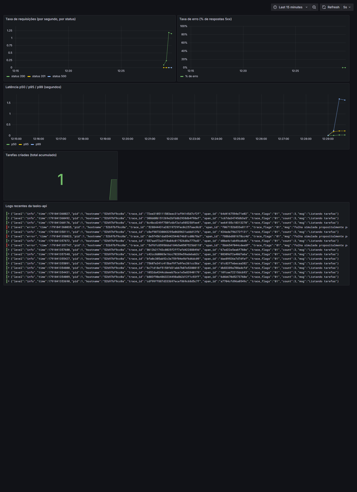

# Observabilidade na Prática — Logs, Métricas e Traces Correlacionados

Projeto de portfólio que demonstra os **três pilares da observabilidade** (logs, métricas e traces) funcionando juntos, de verdade, numa stack que você sobe localmente com um único comando.

Não é um tutorial de "como instalar o Grafana" — é uma API real (`tasks-api`), instrumentada com **OpenTelemetry**, rodando ao lado de uma stack completa de observabilidade (**Prometheus**, **Loki**, **Tempo**, **Grafana**), com os três pilares **correlacionados entre si**: você consegue sair de um pico de latência num gráfico, cair no trace exato daquela requisição, e de lá pular direto para os logs daquele mesmo request — tudo dentro do Grafana, sem trocar de ferramenta.



> Projeto de portfólio, feito para demonstrar como instrumentar e observar um serviço do zero. Sinta-se à vontade para clonar, rodar e usar como referência.

---

## Por que isso importa (e por que não é "só mais um projeto de teste")

Os outros projetos desta série de portfólio testam software **antes** dele ir para produção (testes de UI, de API, de performance). Esse aqui é sobre o que acontece **depois**: quando algo dá errado em produção, como você descobre o quê, onde e por quê — rápido.

Um engenheiro de QA/SDET que entende observabilidade consegue:
- Investigar uma falha intermitente em produção que nenhum teste automatizado pegou
- Entender o impacto real de uma regressão de performance (não só "ficou mais lento", mas "ficou mais lento para quais usuários, em qual rota, desde quando")
- Escrever testes melhores porque entende como o sistema realmente se comporta sob carga

---

## Os três pilares, e como eles se conectam aqui

| Pilar | O que responde | Ferramenta usada aqui |
|---|---|---|
| **Métricas** | "Algo está errado?" — números agregados ao longo do tempo (taxa de erro, latência, throughput) | Prometheus + Grafana |
| **Traces** | "Onde, exatamente, dentro dessa requisição?" — o caminho completo de uma única requisição através do sistema | Tempo (via OpenTelemetry) |
| **Logs** | "O que aconteceu, em detalhe, nesse ponto específico?" — a mensagem exata que o código escreveu | Loki (via Promtail) |

A parte que costuma faltar em tutoriais é a **correlação** entre os três — e é o centro deste projeto:

1. Toda linha de log da `tasks-api` inclui o `trace_id` e `span_id` da requisição que a gerou (veja `app/src/logger.js`).
2. O Grafana está configurado (`grafana/provisioning/datasources/datasources.yaml`) para reconhecer esse `trace_id` dentro do texto do log e virar um link clicável direto para o trace correspondente no Tempo.
3. E o caminho inverso também existe: dentro de um trace no Tempo, o Grafana mostra um botão que já abre os logs daquele intervalo de tempo e serviço no Loki.

Assim, o fluxo de investigação de um problema real fica: **métrica mostra o sintoma → trace mostra onde → log mostra o detalhe** — tudo clicando, sem copiar/colar timestamps entre abas.

---

## Como rodar

Pré-requisito: **Docker** e **Docker Compose** instalados (o Docker Desktop já inclui os dois).

```bash
docker compose up -d --build
```

Isso sobe 7 containers: a API, o OpenTelemetry Collector, Tempo, Prometheus, Loki, Promtail e Grafana. Dá alguns segundos para tudo subir, depois:

- **Grafana**: [http://localhost:3001](http://localhost:3001) (sem necessidade de login — autenticação anônima habilitada de propósito, só para facilitar a demonstração local; **nunca** faça isso assim num ambiente real)
- **API**: [http://localhost:3000](http://localhost:3000)
- Prometheus: [http://localhost:9090](http://localhost:9090)
- Tempo (API): [http://localhost:3200](http://localhost:3200)

No Grafana, o dashboard **"Tasks API - Visão Geral (RED)"** já vem pronto (foi provisionado automaticamente, veja `grafana/provisioning/dashboards/`).

### Gerando tráfego para ver os gráficos se mexendo

```bash
# Requisições normais
curl http://localhost:3000/tasks
curl http://localhost:3000/tasks/1
curl -X POST http://localhost:3000/tasks -H "Content-Type: application/json" -d '{"title":"Minha tarefa"}'

# Rota que simula erros e latência alta aleatoriamente — ótima para ver a
# taxa de erro e os percentis de latência reagirem no dashboard
curl http://localhost:3000/tasks/_chaos/simulate
```

Rode esses comandos em loop (ou várias vezes seguidas) e observe o dashboard atualizando a cada 5 segundos.

### Parar tudo

```bash
docker compose down
```

---

## Estrutura do projeto

```
observability-otel-demo/
├── app/                              # a aplicação instrumentada (Node.js + Express)
│   ├── tracing.js                    # bootstrap do OpenTelemetry (carregado antes de tudo)
│   ├── src/
│   │   ├── index.js                  # servidor Express + middleware de métricas
│   │   ├── logger.js                 # logger que injeta trace_id/span_id em cada linha
│   │   ├── metrics.js                # métricas customizadas (Prometheus)
│   │   └── routes/tasks.js           # rotas de negócio (CRUD de tarefas) + rota de caos
│   └── Dockerfile
├── otel-collector/config.yaml        # recebe traces da app (OTLP) e encaminha para o Tempo
├── tempo/tempo.yaml                  # armazenamento e API de traces
├── prometheus/prometheus.yml         # faz scrape do endpoint /metrics da app
├── loki/loki-config.yaml             # armazenamento de logs
├── promtail/promtail-config.yaml     # coleta os logs dos containers Docker e envia ao Loki
├── grafana/provisioning/
│   ├── datasources/datasources.yaml  # conecta o Grafana a Prometheus, Loki e Tempo (+ correlação)
│   └── dashboards/                   # dashboard pré-configurado
└── docker-compose.yml                # amarra tudo
```

---

## Decisões que valem a pena explicar

- **Por que um OpenTelemetry Collector no meio, em vez da app falar direto com o Tempo?** Porque isso desacopla a aplicação do backend de observabilidade específico. A app só sabe falar o protocolo padrão (OTLP); trocar o Tempo por outra ferramenta de tracing no futuro não exigiria tocar em uma linha do código da aplicação, só na configuração do Collector.

- **Por que `route` nas métricas usa `req.route.path` em vez de `req.path`?** Essa é uma armadilha real e comum: se você usar o path literal, `/tasks/1`, `/tasks/2`, `/tasks/3`... cada id de tarefa vira uma série temporal diferente no Prometheus ("alta cardinalidade"), o que degrada a performance do Prometheus e quebra qualquer agregação. Usar o path da *rota* (`/tasks/:id`) agrupa tudo corretamente.

- **Por que existe uma rota `/tasks/_chaos/simulate`?** Sem ela, a demonstração não teria nada interessante para mostrar — tudo daria sempre certo e rápido. Ela injeta falhas e latência aleatoriamente de propósito, só para os gráficos terem alguma variação para observar (um pouco como o Chaos Monkey da Netflix, só que em miniatura).

- **Por que autenticação anônima no Grafana?** Só para remover fricção numa demonstração local de portfólio. Em qualquer ambiente real, isso deveria estar desligado — fica documentado aqui de propósito, para não passar a impressão de que é uma prática recomendada.

---

## Aulinha: como instrumentar um serviço do zero, sem IA

### 1. Instale o Docker

Baixe o Docker Desktop em [docker.com](https://www.docker.com/products/docker-desktop/) — ele já inclui o Docker Compose.

### 2. Instrumente sua aplicação com OpenTelemetry

Para uma app Node.js, a receita básica é:

```bash
npm install @opentelemetry/sdk-node @opentelemetry/auto-instrumentations-node @opentelemetry/exporter-trace-otlp-http
```

Crie um arquivo que inicializa o SDK **antes** de qualquer outro código rodar (isso importa: as bibliotecas usam "monkey-patching" para se instrumentar, e precisam ser interceptadas antes de serem importadas pelo resto da aplicação):

```js
// tracing.js
const { NodeSDK } = require('@opentelemetry/sdk-node');
const { getNodeAutoInstrumentations } = require('@opentelemetry/auto-instrumentations-node');
const { OTLPTraceExporter } = require('@opentelemetry/exporter-trace-otlp-http');

const sdk = new NodeSDK({
  traceExporter: new OTLPTraceExporter({ url: 'http://localhost:4318/v1/traces' }),
  instrumentations: [getNodeAutoInstrumentations()],
});

sdk.start();
```

E rode sua app assim:

```bash
node --require ./tracing.js src/index.js
```

Com isso, chamadas HTTP, consultas a banco de dados e outras operações comuns já geram traces automaticamente, sem você escrever código manual para a maioria dos casos.

### 3. Exponha métricas customizadas

```bash
npm install prom-client
```

```js
const client = require('prom-client');
client.collectDefaultMetrics(); // métricas padrão do processo (memória, CPU, etc)

const counter = new client.Counter({ name: 'minha_metrica_total', help: '...' });
counter.inc(); // incrementa quando o evento que te interessa acontece

app.get('/metrics', async (req, res) => {
  res.set('Content-Type', client.register.contentType);
  res.end(await client.register.metrics());
});
```

### 4. Faça os logs incluírem o trace_id

```js
const { trace, context } = require('@opentelemetry/api');

function logWithTrace(msg) {
  const span = trace.getSpan(context.active());
  const traceId = span?.spanContext().traceId;
  console.log(JSON.stringify({ msg, trace_id: traceId }));
}
```

Essa única linha (`trace_id`) é o que transforma três ferramentas separadas numa experiência de investigação conectada.

### 5. Suba a stack de observabilidade com Docker Compose

Monte um `docker-compose.yml` com os serviços que você precisa (veja o deste projeto como referência) — tipicamente: sua app, um OTel Collector, um backend de traces (Tempo/Jaeger), Prometheus, Loki, Promtail e Grafana.

### 6. Conecte o Grafana às três fontes

No `docker-compose.yml`, monte uma pasta de "provisioning" dentro do container do Grafana — isso evita ter que clicar manualmente em "Add data source" toda vez que a stack sobe:

```yaml
grafana:
  image: grafana/grafana:11.3.1
  volumes:
    - ./grafana/provisioning:/etc/grafana/provisioning:ro
```

E dentro de `grafana/provisioning/datasources/datasources.yaml`, declare Prometheus, Loki e Tempo — com o campo `derivedFields` (no Loki) e `tracesToLogsV2` (no Tempo) para habilitar a correlação entre eles, como feito neste projeto.

### 7. Crie o repositório no GitHub e suba o projeto

```bash
git init
git add .
git commit -m "primeiro commit"
git branch -M main
git remote add origin https://github.com/SEU_USUARIO/nome-do-repo.git
git push -u origin main
```

### 8. CI (GitHub Actions)

O workflow `.github/workflows/smoke-test.yml` deste projeto sobe a stack inteira no runner do GitHub Actions, gera tráfego de exemplo, e confirma que métricas, traces e logs realmente chegaram nos três backends — não só que os containers subiram. Use como referência.
